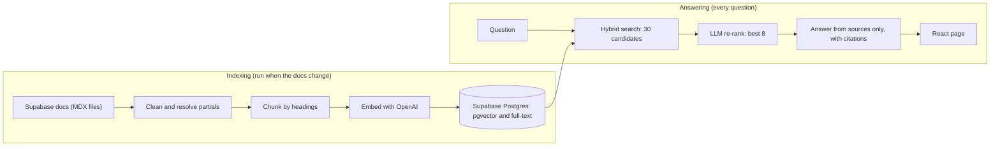

# Supabase Docs Assistant

Ask a question about **Supabase Auth or Database** and get a short answer built **only** from the official docs, with clickable citations to the exact sections it used. If the docs don't cover the question, it says so instead of guessing.

**Live demo:** https://supabase-docs-assistant.onrender.com
*(Free hosting: the first question after a quiet period can take up to a minute while the server wakes up.)*


## What it does

- Answers questions about the Supabase **Auth** and **Database** guides, with `[1]`-style citations that link to the exact doc section.
- Says *"I couldn't find that in the docs"* when the retrieved sources don't contain the answer.
- Finds both meaning ("why is my policy slow?") and exact terms (`pgrst.db_plan_enabled`, `42501`) using hybrid search.
- Shows which sources were used and which were only considered.

## How it works



1. **Prepare the docs.** About 180 MDX pages (Auth and Database guides) from the public `supabase/supabase` repository, checked out in October 2026. MDX components, comments and link URLs are cleaned; shared **partials** and **code samples** that the live site pulls in are resolved and inlined.
2. **Chunk.** Pages are split along their headings. Every chunk keeps its heading path and a deep link to its section. Code blocks are never cut, large tables are split by rows with the header repeated, and tiny parent headings merge into their first subsection.
3. **Index.** Chunks are embedded with `text-embedding-3-small` and stored in Supabase Postgres (`pgvector`) next to a generated full-text column.
4. **Retrieve.** A SQL function runs vector search and keyword search together and merges the two rankings with reciprocal rank fusion. Identical chunks (from shared partials) are collapsed.
5. **Re-rank.** A model reads short excerpts of the top 30 candidates and picks the 8 that best answer the question. If this step fails, the original order is used.
6. **Answer.** A model writes the answer from those 8 sources only, cites them by number, and replies `NOT_FOUND` when they don't contain the answer.
7. **Serve.** An Express API (rate-limited, with a daily cap) and a React page that turns `[1]` markers into links.

## Engineering notes: problems I found and fixed

Most of the work was making the data right. A few examples:

- **Windows line endings** (`\r\n`) silently stopped headings from being detected, so whole pages became one chunk.
- **Nested code fences** (a ```` block containing a ``` line) flipped my "am I inside code?" tracking, which swallowed real headings. I now track the fence character and length.
- **Hidden text.** Multi-line MDX comments leaked text the live site never shows, including commented-out headings. They are now stripped before the page is split.
- **Content that isn't in the file.** Pages include shared snippets (`<$Partial>`) and sample code (`<$CodeSample>`) rendered at build time. Resolving them added 96 partials and 38 code samples to the index.
- **SDK-specific sections** (`<$Show if="sdk:dart">`) are kept with a visible `[sdk:dart]` label, so Python, Dart and C# answers don't blur together.
- **Exact identifiers.** Vector search missed a page when queried with an exact setting name; hybrid search found it. Postgres treats `pgrst.db_plan_enabled` as one word, so dots become word breaks in both the index and the query.
- **Re-ranking.** For one troubleshooting question, the section that explains the fix ranked 20th by vector similarity; re-ranking moved it to first.
- **A faithfulness failure I found by checking an answer against the docs.** When only a bare bullet ("Call functions with `select`") was retrieved, the model once reversed it into "avoid calling functions with `select`". Tighter prompt rules reduced it, but the missing explanation was a retrieval problem, which is documented below as a limitation.
- **Resilient embedding.** The loader caches every vector on disk, retries failed requests with backoff, and saves with upserts, so a flaky connection never means starting over.

## Limitations

- **Scope:** only the Auth and Database guides, not the API reference or other sections.
- **Not everything is indexed.** Some pages use components that generate their content when the page renders (for example error-code tables, provider lists, extension lists). That content isn't in the source files, so those pages are incomplete in the index.
- **Link targets are dropped** from chunk text, so a bullet that only points to another section ("see X") gives the model nothing to explain. This is the cause of the misread above.
- **It can still be wrong.** A small answering model can misread thin sources. Always check the linked sections.
- **Keyword search needs every word to match,** so natural-language questions rely on the vector half; exact terms and identifiers rely on the keyword half.
- **A snapshot, not live.** Answers reflect the docs as of the last indexing run.
- **Free hosting:** cold starts of up to a minute, and a daily ping keeps the free database from pausing.
- **Evaluation is unfinished.** `src/eval.ts` scores retrieval against a hand-written question set, but several of my "expected pages" turned out not to be in the index, so I'm cleaning the set before quoting a number.

## Run it yourself

Requires Node 22.12 or newer (developed on Node 24), an OpenAI API key and a Supabase project.

```bash
git clone https://github.com/BoyNamedIkenna/supabase-docs-assistant.git
cd supabase-docs-assistant
npm install
cd web && npm install && cd ..
```

**1. Create the database.** Run [`sql/schema.sql`](sql/schema.sql) in the Supabase SQL editor.

**2. Add a `.env` file** in the project root (see the table below).

**3. Get the docs** (a sparse checkout of just what's needed):

```bash
git clone --filter=blob:none --depth 1 --sparse https://github.com/supabase/supabase.git source
cd source
git sparse-checkout set apps/docs/content/guides apps/docs/content/_partials examples/auth/expo-social-auth examples/auth/hono examples/auth/nextjs examples/auth/quickstarts examples/auth/sveltekit examples/auth/tanstack examples/clerk
cd ..
```

**4. Chunk and index:**

```bash
npx tsx src/inspect.ts   # chunks the docs, prints a quality report, writes chunks.json
npx tsx src/embed.ts     # embeds the chunks and loads them into Supabase
```

**5. Ask from the command line, or start the app:**

```bash
npx tsx src/ask.ts "How do I sign users in anonymously?"

npx tsx src/server.ts            # API on http://localhost:3001
cd web && npm run dev            # page on http://localhost:5173
```

### Configuration

| Variable | Needed | Purpose |
|---|---|---|
| `OPENAI_API_KEY` | yes | Embeddings, re-ranking and answers |
| `SUPABASE_URL` | yes | Your project URL |
| `SUPABASE_SECRET_KEY` | yes | Server-side key. Never expose it to the browser. |
| `CHAT_MODEL` | no | Answering model (has a default) |
| `RERANK_MODEL` | no | Re-ranking model (defaults to `CHAT_MODEL`) |
| `RERANK=off` | no | Skip the re-ranking step |
| `ALLOWED_ORIGIN` | when deployed | The page's address, for CORS |
| `MAX_PER_MINUTE`, `DAILY_LIMIT` | no | Per-visitor and total daily question limits (10 and 300) |
| `VITE_API_URL` (in `web/`) | when deployed | The API's address |

## Project structure

```
src/
  sections.ts, clean.ts, includes.ts, chunker.ts   docs -> chunks
  inspect.ts                                       chunking quality report
  embed-lib.ts, embed.ts                           embedding (cache, retries) and loading
  search-lib.ts, search.ts                         duplicate removal, command-line search
  rerank-lib.ts, ask-lib.ts, answer.ts, clients.ts re-ranking, prompts, the answering pipeline
  app.ts, server.ts, rate-limit.ts                 the API
  ask.ts                                           command-line question
  eval-lib.ts, eval.ts                             retrieval evaluation
web/                                               React + Vite + Tailwind page
sql/schema.sql                                     table, search functions, security settings
render.yaml, .github/workflows/keepalive.yml       deployment and daily keep-alive
```

## Deployment

The page (a static site) and the API (a web service) both run on Render and are created from `render.yaml`. A daily GitHub Actions ping keeps the free Supabase project from pausing. The database table has Row Level Security on with no policies, so only the server's secret key can read it.

## Roadmap

- Finish the evaluation set and publish retrieval scores.
- Keep link targets in chunk metadata so "see X" pointers can be followed.
- Stream answers as they are written.
- Let visitors pick their SDK and show only that language's code.
- Add automated tests and CI.

## Acknowledgements

All documentation content belongs to [Supabase](https://supabase.com/docs) and is indexed from the public [supabase/supabase](https://github.com/supabase/supabase) repository. This project is not affiliated with or endorsed by Supabase, and the docs themselves are not redistributed in this repository.